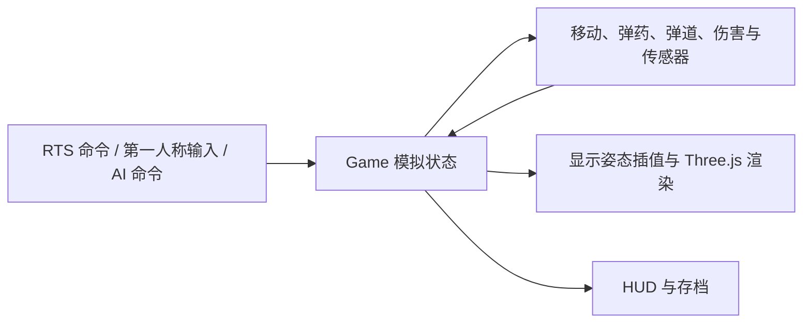

# 技术实现与源码阅读路线

作者：AYUAN。本文对应 3.16.0，面向希望学习、复现或迁移其中机制的开发者。项目使用 JavaScript、Three.js 和 Electron；以下亮点以仓库内实现和已有验收记录为依据。

## 1. 一个战场，两种操作方式

玩家可以指挥部队，也可以接管人员或载具。切换视角时继续使用当前游戏实体，生命、弹药、位置和战斗结果由模拟层维护；界面与镜头读取这些状态。



主循环以 0.05 秒步长更新模拟，即 20 Hz，并限制单帧追赶次数。驾驶镜头和被驾驶实体的显示姿态在渲染帧间插值；射击仍按模拟中的炮口姿态计算。暂停、传送与换乘要重置插值状态，避免把旧实体的位置带入新视角。

可以借鉴的原则：显示层可以平滑位置，但不要用平滑后的显示状态覆盖实际碰撞、弹药和伤害状态。固定步长本身也不等于跨机器完全确定性；负载过大时仍可能追不上实际时间。

源码：[主循环](../src/app.js)、[直接控制](../src/direct-control.js)、[战场显示](../src/battle3d.js)、[模拟](../src/sim.js)。验证：[直接控制测试](../tests/direct-control.test.cjs)、[第一人称性能记录](fps-performance-desktop-report.json)。

## 2. 寻路不仅检查中心点

车辆与舰船具有长度、宽度和朝向。路线能让一个点通过，不代表整个车体能通过；多个单位共用一个终点也会造成堆叠。

当前实现将静态网格寻路、旋转包络检查、分层占位、目标停位分配和局部避让结合起来。卡住后在有限预算内重新规划，避免同一帧所有单位同时搜索。地面与航空滑行保留完整占地检查；空中移动按高度层处理。

3.16 修复了一个典型误判：建筑膨胀后的粗网格把真实可通行的窄走廊封死。A* 没有路径时，再检查完整车体沿连续直线经过的空间；通过检查才采用该路线。完全封闭的障碍仍然不能穿越。

迁移时应保留三种不同状态：已找到路线、实际不可通行、当前规划预算不足。把“这一帧还没来得及搜索”当成“路线被堵住”，会让恢复队列反复覆盖有效命令。

源码：[导航包络](../src/navigation-footprints.js)、[群体导航](../src/crowd-navigation.js)、[路径与命令](../src/sim.js)。验证：[建筑导航](../tests/friendly-building-navigation.test.cjs)、[群体导航](../tests/crowd-navigation.test.cjs)、[窄走廊与返航回归](../tests/recovery-navigation-316.test.cjs)。

## 3. 高速弹体与镜头瞄准分别处理

高速弹体可能在一个模拟步中跨过整个目标。只检查更新后的落点，容易漏掉中途碰撞。项目检查上一位置到新位置之间的连续路径，并在精确碰撞前排除明显不相交的候选对象。

第一人称还要处理镜头与炮口的位置差异：镜头能看见目标，不表示炮口没有被墙或车体遮住。发射时保存世界空间起点和方向，避免转动镜头后旧弹迹跟着旋转。导弹、火箭、炸弹和鱼雷使用各自的飞行与效果逻辑；火光和烟雾只负责表现，不额外计算一次伤害。

适合迁移的用例：近距离遮挡、极端俯仰角、高速越过小目标、发射后转头，以及同一模拟步中的发射与命中。

源码：[连续弹体](../src/combat-projectiles.js)、[瞄准与炮口](../src/direct-control.js)、[开火效果](../src/weapon-effects.js)。验证：[弹体测试](../tests/combat-projectiles.test.cjs)、[弹迹投影](../tests/fps-projectile-projection.test.cjs)、[48 个弹道验收案例](fps-ballistics-desktop-report.json)。这些是游戏化弹道与碰撞，不是现实武器工程模型。

## 4. 玩家与 AI 交接的是控制权

指挥官托管与第一人称护卫复用已有规则 AI。单位收到明确的手动命令后，记录人工控制归属；AI 自己下达的命令也单独记录。关闭托管时取消相关 AI 命令，保留人工操作和已付费的生产队列。

控制权状态随存档保存，并处理玩家直接驾驶、人员乘载与单位死亡。这样可以避免 AI 每隔几秒把玩家刚下达的命令改回去。

这是规则调度，不依赖联网大模型。护卫效果受资源、兵力、探测与武器目标域限制，无法保证基地永远安全。

源码：[指挥官控制权](../src/commander-ai.js)、[玩家模式](../src/player-mode.js)、[AI 决策所在模拟模块](../src/sim.js)。验证：[托管与人工命令测试](../tests/commander-ai.test.cjs)。

## 5. 航空单位使用完整作业流程

飞机起飞、巡航、返航、进近、滑行与维修采用阶段状态，而不是在到达目标后直接重置位置。机场与跑道职责分开；航母放飞的是可驾驶、受损和返航的真实游戏实体。

这里有几个可以用于其他作业模拟的经验：重复返航命令应保持当前进近进度；基地失效后应重新选择服务点；滑行目标按坐标比较，不能因每帧创建了新的目标对象而反复重算；位置和角度要一起接受碰撞检查。

源码：[航空流程](../src/aircraft-flight.js)、[独立跑道](../src/airbase-runways.js)、[舰载机](../src/carrier-operations.js)。验证：[航空回归](../tests/aircraft-flight.test.cjs)、[返航维修回归](../tests/recovery-navigation-316.test.cjs)、[舰载航空回归](../tests/carrier-operations.test.cjs)。流程可供状态机设计参考，速度、航时与高度均包含游戏压缩。

## 6. 探索地图与发现敌人分开

地形已经被探索过，不代表当前仍能看到区域里的敌人。光学、雷达、声呐和轨道测绘分别定义适用目标域及范围；武器射程也不直接充当探测范围。电子传感器会检查供电与 EMP 等当前状态。

优化时只保存“上次成功发现目标的观察者”作为优先检查线索，每次仍重新验证其位置、存活、成员身份和有效性。这样既减少重复遍历，也避免断电后继续沿用过期的可见性结果。

地理地图则使用固定来源的 Natural Earth 海陆轮廓，经过裁剪、投影与栅格化后离线加载。地理边界、地图尺寸、存档与寻路要一致；新增地图不应悄悄改变旧地图的尺寸。

源码：[传感器](../src/sensors.js)、[地图生成](../tools/build-geographic-maps.cjs)、[尺寸约束](../src/map-dimensions.js)。验证：[传感器](../tests/sensors.test.cjs)、[缓存失效](../tests/hotpath-equivalence.test.cjs)、[地理地图](../tests/geographic-maps.test.cjs)。Natural Earth 的 1:50,000,000 是制图比例，不是 50 米精度；基地与矿山均为虚构部署。

## 7. 性能优化同时检查结果是否正确

3.16 的优化覆盖稳定武器资料缓存、实体索引、空间查询、观察者线索、候选目标与落点筛选、模型节点查找，以及远景动画分级。远景履带保留原几何与材质，减少活跃骨骼；近景或选中后恢复完整关节。大型指挥视角降低阴影刷新频率，第一人称保留逐帧阴影。

优化的关键约束是：资料可以缓存，实体死亡、替换、移动、阵营/类型变化、断电和 EMP 等当前状态必须正确使缓存失效或触发重新检查。候选筛选也应保留原行为，而不是为了帧率静默删掉真实弹体或伤害。

| 配对 320 单位交战指标 | 3.15.0 | 3.16.0 |
|---|---:|---:|
| 平均 FPS | 2.58 | 34.84 |
| P95 帧时间 | 499.9 ms | 44.2 ms |
| 平均模拟步 | 68.37 ms | 18.78 ms |

环境：RTX 3060，1500×980 CSS 像素，DPR 1.25；双方各 160 个作战单位、另加 2 个总部，12 秒且均开启 CPU 采样。该固定密集场景测得约 13.5 倍平均 FPS，不能外推成所有场景均提升 13.5 倍。640 单位、60 秒、无 CPU 采样的另一组极密压力只有 5.01 FPS，仍是未解决的性能上限。

源码：[动画分级](../src/vehicle-animation.js)、[渲染](../src/battle3d.js)、[空间查询与资料缓存](../src/sim.js)。验证：[等价性与失效测试](../tests/hotpath-equivalence.test.cjs)、[压力测试入口](../tests/peak-combat-desktop.cjs)、[原始数据与完整复现](PEAK_RECOVERY_316.md)。函数计时包含嵌套，不能相加；CPU 绘制提交耗时也不等于 GPU 耗时。

## 怎样从中学习或迁移

1. 先在仓库根目录执行 `npm start`，通过浏览器体验行为，再读相关模块。
2. 选择一个小范围问题，例如“手动命令不被 AI 覆盖”或“缓存必须在实体死亡后失效”。先读对应测试，再读实现。
3. 在自己的项目中提取最小接口。现有模块常通过 `globalThis.War*`、`Game` 和共享数据交互，直接复制单个文件通常不能独立运行。
4. 建立一个可以稳定复现的场景，记录修改前后结果。修改导航时同时检查到达、重叠和穿模；修改性能时同时检查帧时间、模拟时间与功能。

在已安装 Node.js 的仓库根目录，可以先运行一组较小的行为测试：

```sh
node --test tests/commander-ai.test.cjs tests/hotpath-equivalence.test.cjs tests/recovery-navigation-316.test.cjs
```

完整 CPU 测试使用 `npm test`。Windows EXE、Playwright 和指定分辨率等原生验收前提见 [验证记录](VALIDATION.md) 与 [性能复现](PEAK_RECOVERY_316.md)。已有报告记录的是当时环境的结果，自己的机器仍需重新测量。

3.16.0 的发布验证包含 1036 项通过的 CPU 测试、21 组独立版检查/压力采样、启动入口验证及包内源码哈希检查。可以借鉴 [原生验收启动器](../tests/combat-desktop-harness.cjs) 的做法：启动真正交付的 EXE、隔离测试存档、检查包内源码与模型加载状态，避免只验证开发环境。

本项目原创代码与原创资产的许可见 [LICENSE](../LICENSE)；第三方模型、纹理和其他内容按 [第三方说明](../THIRD_PARTY_NOTICES.md) 及各资产许可证处理。迁移代码时不要把独立授权的美术资产一并视为项目原创资产。

## 可以继续贡献的方向

- 用可复现样本改善 640 单位密集混战，记录帧时间与模拟时间比，保留碰撞和伤害结果。
- 为窄路、动态新建筑、失效维修点和多单位交汇增加失败案例。
- 逐项完善有公开参考和明确许可的模型，保留来源及外形核验记录。
- 把目前耦合的全局模块逐步整理成可独立测试的接口；先选择一个模块验证，再扩大范围。

提交 Issue 时附版本/提交号、复现步骤、预期与实际结果；性能问题另附 CPU/GPU、分辨率、地图、单位数和采样时长。欢迎附代码或基准数据，让改进可以被别人重复验证。
